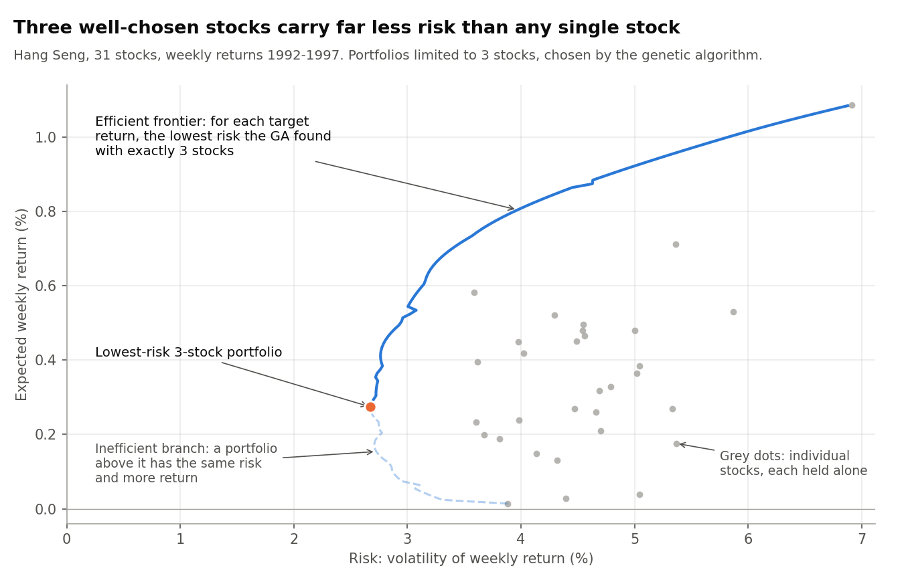
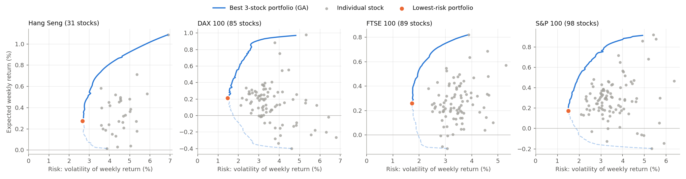

# Survival of the Fittest Portfolio

**Choosing which stocks to hold with a genetic algorithm (MATLAB).**

Suppose you may hold only *k* stocks out of a market of *N*, and you want a target return at the lowest possible risk. Which *k* stocks should you buy, and how much of each? This project answers that with a **genetic algorithm (GA)**: a population of candidate portfolios is evolved, survival of the fittest, until it settles on the subsets of stocks that give the least risk. A classic quadratic-programming step then sets the exact amount to invest in each chosen stock.

The project was PhD coursework for the *Optimisation Methods* course (Javier Molina, February 2006). This repo holds a cleaned-up version of the original code, the data it used and the results it produced.

### Genetic algorithms in a nutshell

A genetic algorithm is a search method modelled on natural selection. It does not improve a single solution step by step. Instead it keeps a **population** of candidate solutions, each encoded as a **chromosome** (here, the list of stocks a portfolio holds). Every generation, each candidate is scored by a **fitness function** that says how good it is. **Selection** then picks parents, favouring the fitter candidates. **Crossover** combines two parents into a child that inherits traits from both, and **mutation** makes small random changes so the population keeps exploring new options and does not converge too early. The best few candidates (the **elite**) pass to the next generation unchanged. Over many generations, good building blocks spread through the population and poor ones die out. GAs need no gradients, no convexity and no smooth search space, which makes them well suited to combinatorial problems where the number of possible solutions is astronomically large. Choosing *k* stocks out of a hundred is such a problem.



**How to read the chart.** Each grey dot is one Hang Seng stock held on its own: further right means riskier, higher means more return. The blue curve is the result of the search. For every target return the GA was asked to reach, it shows the risk of the best 3-stock portfolio it found. The curve sits well to the left of almost every dot: combining three stocks whose prices do not move together gives the same return with much less risk. Only the solid upper part is worth investing in. The dashed lower branch is *inefficient*, because a portfolio directly above it has the same risk and a higher return. The orange point is the lowest-risk portfolio of all. The few small kinks are a trait of the GA's stochastic search (see [Accuracy against the exact optimum](#accuracy-against-the-exact-optimum)).

## The problem

Classic Markowitz portfolio selection picks weights *w* over *N* assets to minimise risk for a target return:

```
minimise    w' Σ w                    (portfolio variance)
subject to  μ' w = R*                 (target mean return)
            Σ wᵢ = 1,  0 ≤ wᵢ ≤ 1     (fully invested, no short selling)
```

That is a convex quadratic programme (QP), which is easy to solve. Real investors usually also want to hold a **fixed small number of assets**. This project adds that constraint:

```
            exactly k of the wᵢ are non-zero      (cardinality constraint)
```

With it, the problem becomes a mixed-integer QP. There are C(N, k) possible asset subsets: for the S&P 100 problem with k = 9, that is about 2·10¹². Enumerating them all is out of the question.

## Approach: GA over subsets + exact QP for weights

The search is split in two:

| Layer | What it decides | How |
|---|---|---|
| Outer (combinatorial) | *which* k assets | Genetic algorithm, MATLAB `ga` with a custom population type |
| Inner (continuous) | *how much* of each | Exact QP with `quadprog`, which serves as the GA's fitness |

This is how the GA concepts above map onto the problem:

- **Chromosome.** A set of k distinct asset indices, e.g. `[4 17 23]`.
- **Fitness.** The minimum variance reachable with those k assets at return R\*, computed by `quadprog`. Lower is fitter. A subset that cannot reach R\* scores `Inf`.
- **Initial population.** Random k-subsets. The population size is 2N.
- **Crossover: R3 (Random Respectful Recombination).** The child keeps every asset both parents share. The remaining slots are filled at random from assets held by only one parent. Parents that hold the same assets are not paired with each other while a different partner is still available.
- **Mutation.** One held asset is swapped for a random asset not yet held.
- **Selection and elitism.** MATLAB defaults: rank-based fitness scaling and stochastic uniform selection, with the best individuals carried over unchanged.
- **Stopping.** At most 100 generations, or 10 generations without improvement.

Sweeping R\* from the lowest to the highest mean return and recording the minimum variance at each value traces the **cardinality-constrained efficient frontier**, the blue curve in the charts.

For the small Madrid problem (N = 5), `solve_exhaustive` checks all C(5, 3) = 10 subsets. Its result is the exact optimum, which validates the GA.

## Results on the four benchmarks

The same picture holds for all four OR-Library markets: the GA's 3-stock portfolios dominate nearly every individual stock.



The charts were produced by [`scripts/run_frontiers.py`](scripts/run_frontiers.py), a Python port of the MATLAB GA with the same operators and settings, with one GA run per target return.

### Accuracy against the exact optimum

For the Hang Seng with k = 3 there are only C(31, 3) = 4,495 subsets, so the exact frontier can be computed by checking them all. Measured against it over 30 runs at each of the 108 target returns ([`scripts/mutation_experiment.py`](scripts/mutation_experiment.py)), the GA:

- finds the exact best 3 stocks in **89 %** of runs;
- otherwise comes very close: portfolio volatility is on average **0.2 %** above the optimum, and within 1.7 % in 95 % of runs;
- needs about 15 generations, under 1,000 fitness evaluations per run.

The original 2006 runs, which used an earlier variant of the mutation operator, found the optimum at 59 % of the target returns and were within 1.9 % of it on average.

The small kinks left in the curves are normal for a stochastic search, since each target return is a separate run. Repeating each run and keeping the best result, or warm-starting each run from its neighbour's elite (see [Ideas left open](#ideas-left-open-from-the-2006-report)), would smooth them further.

## Data

| Set | Assets | Source |
|---|---|---|
| `data/madrid/` | 5 Madrid Stock Exchange stocks (Adolfo Domínguez, Banco Santander, Endesa, Repsol, Telefónica), 507 daily closing prices each | Collected for the coursework |
| `data/orlib/port1.txt` | 31 · Hang Seng | [OR-Library](http://people.brunel.ac.uk/~mastjjb/jeb/orlib/portinfo.html), J. E. Beasley |
| `data/orlib/port2.txt` | 85 · DAX 100 | 〃 |
| `data/orlib/port3.txt` | 89 · FTSE 100 | 〃 |
| `data/orlib/port4.txt` | 98 · S&P 100 | 〃 |

The OR-Library files are the benchmark instances from Chang, Meade, Beasley & Sharaiha (2000). Their format is: N; then one `mean std` line per asset; then one `i j correlation` line per pair.

## Repository layout

```
run_madrid.m                 Madrid example: exact vs GA, plus both frontiers
run_orlib.m                  Frontiers for port1..port4, k = 3..9 (slow)
src/
  load_orlib_portfolio.m     Parse an OR-Library file → μ, Σ
  load_price_series.m        Price files → daily returns → μ, Σ
  min_variance_weights.m     QP on a fixed subset (GA fitness function)
  solve_ga.m                 Genetic algorithm solver
  ga_create_population.m     ┐
  ga_crossover_r3.m          ├ custom GA operators
  ga_mutate_swap.m           ┘
  solve_exhaustive.m         Exact solver by enumerating all subsets (small N only)
  efficient_frontier.m       Sweep target return → [return, variance]
  plot_frontiers.m           Plot helper
results/2026/                    Frontiers from the current GA (k = 3), used in the charts
results/2006/                    Frontiers produced by the original 2006 code (k = 3)
results/mutation_experiment_*.csv Per-target accuracy results, Hang Seng k = 3
scripts/run_frontiers.py         Python port of the GA: computes results/2026/
scripts/plot_frontiers.py        Draws the charts in docs/img/ from results/2026/
scripts/mutation_experiment.py   GA accuracy against the exact optimum, Hang Seng k = 3
docs/report-2006.pdf             Original coursework report (translated from Spanish)
```

## Running

Requires MATLAB (R2019b or later) with the **Optimization Toolbox** (`quadprog`) and the **Global Optimization Toolbox** (`ga`).

```matlab
run_madrid      % seconds: prints exact vs GA weights and plots both frontiers
run_orlib       % hours: writes results/portN_frontier_kK.csv and plots them
```

Individual pieces can also be called directly:

```matlab
addpath src
[mu, Sigma] = load_orlib_portfolio('data/orlib/port1.txt');
[w, variance] = solve_ga(mu, Sigma, 5, 0.006);   % best 5-asset portfolio at 0.6 % weekly return
find(w)'                                          % which assets were picked
```

The Python scripts need numpy and matplotlib and use fixed random seeds:

```bash
python scripts/run_frontiers.py        # about 2 minutes: GA frontiers -> results/2026/
python scripts/plot_frontiers.py       # charts -> docs/img/
python scripts/mutation_experiment.py  # about 7 minutes: accuracy check, Hang Seng k = 3
```

## What changed in the clean-up

The original code (2006-era MATLAB, written in Spanish) was refactored as follows. The algorithm itself is unchanged.

- **Cardinality is passed through to the GA.** The 2006 frontier generator called the GA with a fixed `3`, so the result files labelled k = 4 … 9 are additional k = 3 runs. Only the k = 3 results are kept in `results/2006/`.
- **Fully random mutation.** The original shuffled the candidate stocks, but MATLAB's `setdiff` returns its output sorted, so the lowest-numbered stock not held was always the one inserted. The stock is now drawn at random.
- **Madrid covariance scale.** The covariance was computed as a sum of products rather than a mean. It was too large by a factor of about 505. This scaling leaves the optimal weights unchanged, but it inflates the variance values in `results/2006/madrid_frontier_k3.csv`. The code now uses `cov`.
- **No more temp files.** The original passed μ, Σ and R\* to the fitness function by writing them to temporary CSV files and reading them back on *every* evaluation. They are now captured in closures.
- **One QP routine instead of two.** The two risk functions (one returning only the variance, one also returning the weights) were near-identical. They are merged into `min_variance_weights.m`.
- **OR-Library files are read directly.** The original needed a hand-converted intermediate CSV.
- **Updated API.** `gaoptimset` was replaced with `optimoptions`. Leftover debug output and the dummy inequality constraint were removed.
- **Translated to English.** Code, comments and the report are now in English. The original file names, in the order the report describes them, map as follows:

| 2006 file (literal translation) | Now |
|---|---|
| `Resolucion_Genetica_Minimo_Riesgo` (genetic solution, minimum risk) | `solve_ga` |
| `Resolucion_Cuadratica_Minimo_Riesgo` (quadratic solution, minimum risk) | `solve_exhaustive` |
| `Riesgo` (risk), `Riesgo_con_Devolucion_de_pesos` (risk, also returning weights) | `min_variance_weights` |
| `CrearPoblacionInicial` (create initial population) | `ga_create_population` |
| `CruzarPadres` (cross parents) | `ga_crossover_r3` |
| `GenerarMutacion` (generate mutation) | `ga_mutate_swap` |
| `GeneracionDatosPort` (port data generation) | `load_orlib_portfolio` |
| `GeneracionDatosBolsaMadrid` (Madrid Stock Exchange data generation) | `load_price_series` |
| `GenerarGrafica` (generate chart), `GenerarTodaslasGraficas` (generate all charts) | `efficient_frontier`, `run_orlib` |
| `PresentarGrafica` (show chart), `Presentar_Todas_Graficas` (show all charts) | `plot_frontiers` |

> **Note:** the refactored MATLAB has not been executed, because no MATLAB licence was available during the clean-up. The data loading was cross-checked numerically against the 2006 intermediate files. The 2006 results in `results/2006/` come from the original code; the charts and `results/2026/` come from the Python port.

## Ideas left open (from the 2006 report)

- Replace R3 with **RAR (Random Assorting Recombination)** crossover, which should improve exploration.
- **Warm-start elites.** Neighbouring points on the frontier have similar optimal subsets. Seeding each GA run with the best individuals from the previous target return should speed it up and smooth the frontier.

## References

- H. Markowitz, "Portfolio Selection", *Journal of Finance* 7 (1952) 77–91.
- T.-J. Chang, N. Meade, J. E. Beasley, Y. M. Sharaiha, "Heuristics for cardinality constrained portfolio optimisation", *Computers & Operations Research* 27 (2000) 1271–1302.
- A. Schaerf, "Local search techniques for constrained portfolio selection problems", *Computational Economics* 20 (2002) 177–190.
- N. J. Radcliffe, "Forma analysis and random respectful recombination", *Proc. ICGA* (1991).
